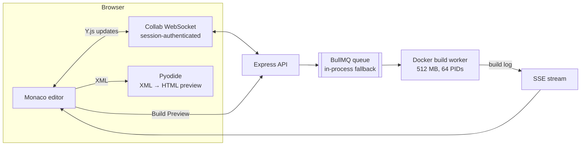

# Proofdesk

A collaborative web editor for PreTeXt textbooks. Authors edit together in a Monaco editor synced with Y.js, see an instant in-browser HTML preview, and run full builds on the server in resource-capped Docker containers fed by a job queue.

[](https://react.dev)
[](https://www.typescriptlang.org/)
[](https://yjs.dev)
[](https://bullmq.io)
[](https://playwright.dev)

| | |
|---|---|
| **Browser preview** | Warm preview: 383 ms median / 505 ms p95 over 50 sandbox runs; excludes the first Pyodide download. See the detailed benchmark report. |
| **Server build** | First container build: 15.4 s median; repeated build in a running container: 7.0 s median. Recorded in a cloud sandbox, 50 runs per condition. |
| **Collaboration** | 0.29 ms median (avg 0.43 ms, p95 1.19 ms) one-way Y.js sync over localhost, 30/30 rounds |
| **Tests** | Frontend (Vitest), backend (node:test), and Playwright end-to-end suites, all run by CI on pushes to `main` and on pull requests |
| **Built by** | Started for the Vanderbilt Mathematics Department; now maintained in the open with contributors (see [Credits](#credits)) |

Browser previews and full server builds produce different outputs; their latencies are not a like-for-like compiler speedup. The recorded timings are sandbox measurements, not production capacity or author productivity claims. [Detailed methods, raw results, and limitations](benchmarks/docker_pipeline/README.md).

---

## How it works



- **Collaboration.** Each document is a Y.js `Y.Text` bound to Monaco. Edits travel as binary Y.js updates over a WebSocket. The server checks the session cookie and that the room belongs to that session's workspace before joining anyone to it.
- **Instant preview.** Pyodide runs a small Python transformer ([`wasmCompiler.ts`](frontend/src/utils/wasmCompiler.ts)) that walks the PreTeXt XML with `ElementTree` and emits HTML. No server round trip. It covers common PreTeXt elements, not the full PreTeXt toolchain.
- **Full builds.** "Build Preview" enqueues a job in BullMQ. If Redis is down, the backend falls back to an in-process queue instead of failing. Workers run the real PreTeXt build in a Docker container capped at `--memory 512m --pids-limit 64` and stream logs back over Server-Sent Events (`GET /build/logs/:sessionId`).
- **Accounts and workspaces.** GitHub sign-in, cookie sessions, git-backed workspaces, team sessions, and share links. Admin routes are gated by an allow-list (`PROOFDESK_ADMIN_LOGINS`).

More detail: [`ARCHITECTURE.md`](ARCHITECTURE.md), [`docs/system-design.md`](docs/system-design.md), [`docs/api-spec.md`](docs/api-spec.md).

---

## Benchmarks

The [Docker pipeline report](benchmarks/docker_pipeline/README.md) separates container builds, the backend API path, and browser previews, with committed raw results. Measurements were recorded against commit `0346b51e` in a 4-vCPU, 16-GB cloud sandbox; they do not establish current production latency. Each condition below has 50 runs.

| Path / condition | Median | p95 |
|---|---|---|
| First container build of a session | 15,364 ms | 15,883 ms |
| Repeated build, running container, unchanged content | 6,992 ms | 7,299 ms |
| Browser preview, warm | 383 ms | 505 ms |
| First browser preview, Pyodide pre-warmed | 611 ms | 1,075 ms |
| First browser preview, not pre-warmed | 2,474 ms | 2,942 ms |

Browser measurements served Pyodide locally and exclude its initial download. The browser renderer supports a subset of PreTeXt and does not produce the full publishable site.

**Correction to the earlier table:** the old 2,914 ms "Docker build" result measured a local-demo editor update dominated by debounce, not a Docker container build. The older five-run browser sample is retained in benchmark history; the table above uses the larger, explicitly scoped run.

The professor's before/after editing-to-publication workflow has not been measured. No author-efficiency percentage is claimed. The existing compile and WebSocket benchmark scripts are documented in [benchmarks/README.md](benchmarks/README.md); run conditions must be recorded when comparing results.

---

## Quick start

```bash
git clone https://github.com/harsharajkumar-273/Proofdesk.git
cd Proofdesk

# Optional: Redis for the BullMQ queue (the backend falls back to an in-process queue without it)
docker-compose up -d redis

npm install
cd backend && npm install && npx prisma db push --schema=prisma/schema.sqlite.prisma && cd ..
cd frontend && npm install && cd ..

npm run dev   # frontend on :3000, backend API on :4000
```

`docker-compose.prod.yml` builds and runs the full stack (nginx, backend, Redis) for deployment. Deploy workflows for AWS EC2 and Oracle Cloud are in [`.github/workflows`](.github/workflows), with guides in [`docs/`](docs/).

```bash
npm test            # frontend + backend unit tests
npm run test:e2e    # Playwright end-to-end tests
```

---

## Limitations

- The in-browser preview handles a subset of PreTeXt. Anything it doesn't support needs a server build.
- Build containers have memory and process limits but no read-only root filesystem or non-root user yet.
- Reported benchmarks use a controlled cloud sandbox and limited content; they do not establish production performance or measured author productivity.

---

## Credits

Proofdesk was started by [@harsharajkumar-273](https://github.com/harsharajkumar-273) for the Vanderbilt Mathematics Department and has been developed in the open since, including during the ELUSOC 2026 open-source program. Contributors:

- [@SakethSumanBathini](https://github.com/SakethSumanBathini): security and authorization fixes (preview ownership, collab room authorization, comment scoping), Redis subscription retries, build-timeout container cleanup, session-cache indexing, and more
- [@rohitkumarnaidu](https://github.com/rohitkumarnaidu) (Bappadala Rohith Kumar Naidu): features from the issue tracker
- [@sanket1035](https://github.com/sanket1035): fixes and improvements

See the [merged pull requests](https://github.com/harsharajkumar-273/Proofdesk/pulls?q=is%3Apr+is%3Amerged) and [`CONTRIBUTING.md`](CONTRIBUTING.md) to get involved.

## License

Proofdesk's own code is licensed under the [MIT License](LICENSE). Copyright (c) 2026 The Proofdesk Authors.

Third-party material bundled in the repository keeps its own license and is **not** covered by that grant. In particular, `backend/assets/ila-toolchain/` is the Georgia Tech *Interactive Linear Algebra* build toolchain, whose license for parts of it still needs confirming with its authors. See [`THIRD_PARTY_NOTICES.md`](THIRD_PARTY_NOTICES.md).
